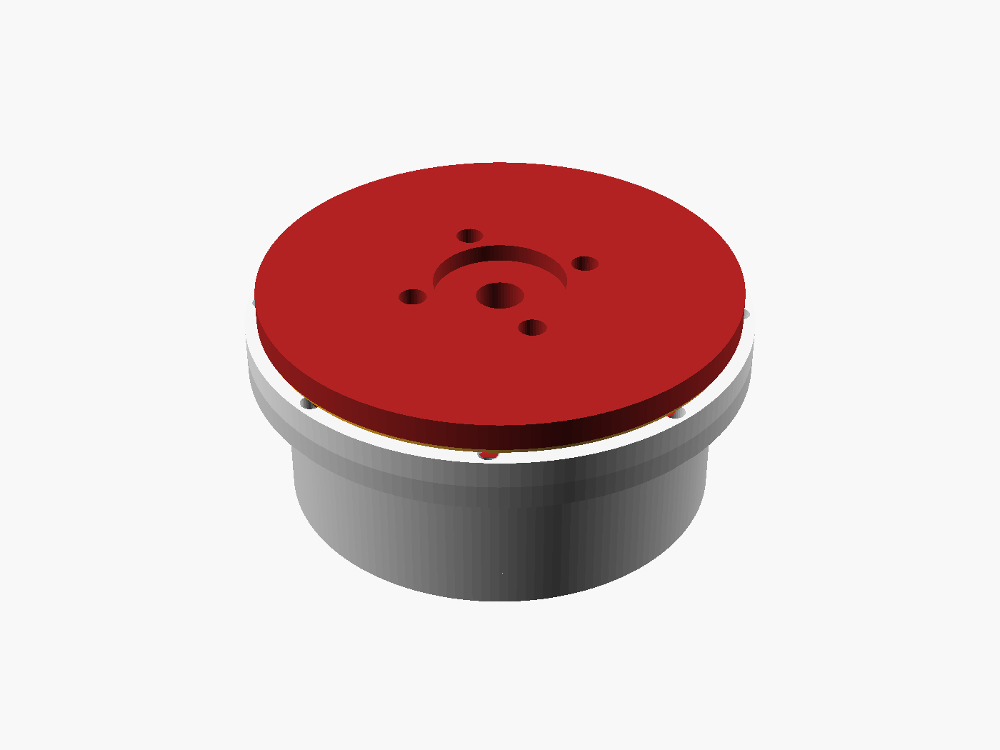
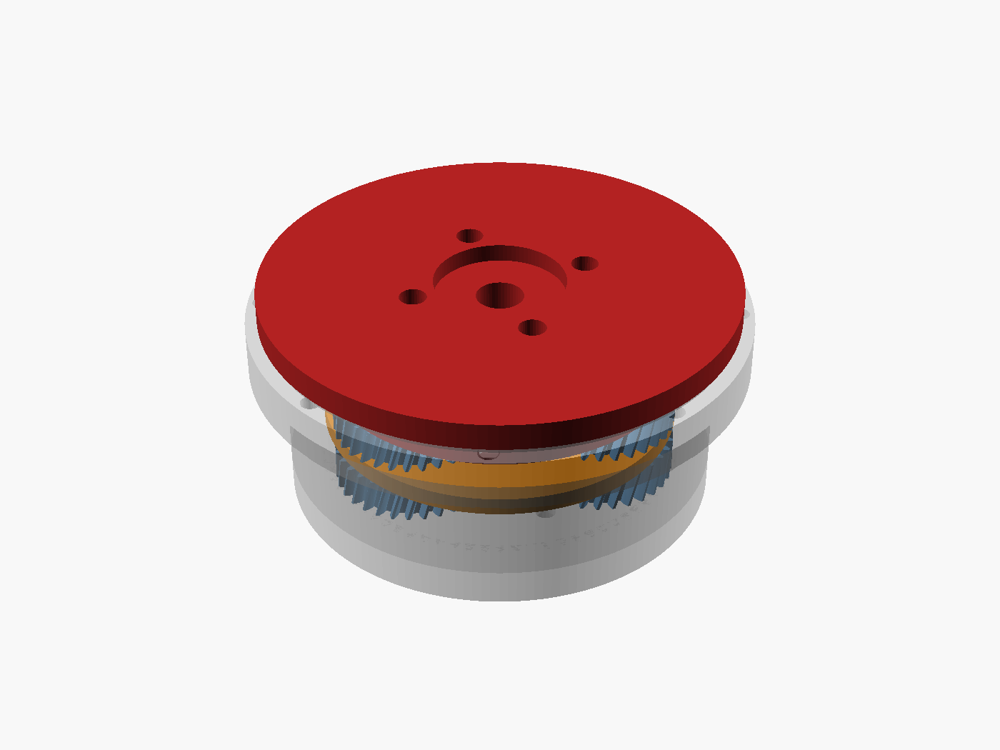
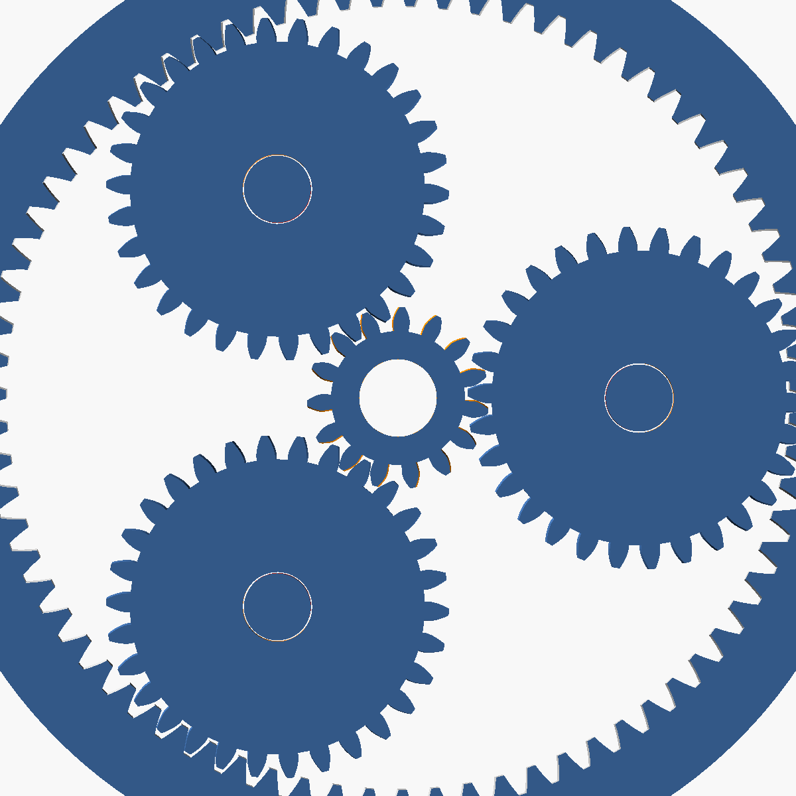

# Atuador 36:1 — NEMA 17 + rolamento de esferas 6 mm

Caixa de engrenagens **planetária helicoidal de 2 estágios, 36:1 exato**, para
motor de passo NEMA 17, com rolamento axial de esferas de airsoft (Ø6 mm) na
saída. Modelo paramétrico em OpenSCAD, projetado para FDM sem suporte (com uma
exceção — ver tabela de impressão).

## Números do projeto

| Item | Valor |
| --- | --- |
| Redução | `(1 + ZR/ZS)² = (1 + 75/15)²` = **36,00:1** |
| Dentes | sun 15 · planeta 30 · anel 75 (3 planetas por estágio) |
| Módulo / pressão / hélice | 0,8 mm · 20° · 15° |
| Distância de centro | 18,0 mm |
| Ø externo × altura | 84 × 38 mm (sem o boss opcional) |
| Massa (PLA, 4 paredes, 40%) | ~120 g impressos |
| Torque na saída | ~8 N·m teórico (NEMA 17 de 0,4 N·m); **use 2–4 N·m** como limite prático dos dentes impressos |

Conferências de projeto já feitas:

- montagem com 3 planetas: `(ZS + ZR) / 3 = 30` (inteiro) ✓
- distância de centro fecha nos dois engrenamentos: `m(ZS+ZP)/2 = m(ZR−ZP)/2 = 18` ✓
- cada planeta pode ser montado em qualquer fase (o pinhão gira no pino) ✓
- mão das hélices: sun à direita, planeta à esquerda (externo), anel à esquerda (interno) ✓

## Vistas

| | |
| --- | --- |
|  |  |
| Montado (Ø84 × 38 mm) | Carcaça translúcida: 2 estágios + carrier |
|  | |
| Corte em z = 19,3: sun 15T, planetas 30T e anel 75T engrenados | |

## Arquivos

```
hardware/3d_models/openscad/
├── atuador.scad          # modelo completo + seletor de peça
├── params.scad           # bloco AT_* (módulo, dentes, alturas, esferas)
├── lib/gear_lib.scad     # involuta externa/interna, helicoidal, pista de esferas
└── out/atuador_*.stl     # STLs prontos para fatiar

hardware/3d_models/atuador/README.md   # este arquivo
```

Renderizar uma peça:

```bash
openscad -o out/atuador_caixa.stl -D 'part="caixa"' atuador.scad
```

No PowerShell as aspas precisam de escape:

```powershell
& $scad -o out\atuador_caixa.stl -D 'part=\"caixa\"' atuador.scad
```

Ou use `.\export.ps1`, que já renderiza tudo em `out/`.

`part` aceita: `assembly` (padrão), `corte` (meia seção), `fatia` (corte
horizontal em `FATIA_Z`), `caixa`, `sun1`, `planeta`, `carrier1`, `saida`,
`tampa`, `gaiola`, `boss`, `cupom`.

## Peças para imprimir

| Peça | Qtd | STL | Orientação | Suporte |
| --- | --- | --- | --- | --- |
| Caixa (2 anéis internos + flange) | 1 | `atuador_caixa.stl` | em pé, prato do motor na mesa | não |
| Sun 1 (entrada) | 1 | `atuador_sun1.stl` | cubo para baixo | não |
| Planeta | 6 | `atuador_planeta.stl` | deitado | não |
| Carrier 1 + sun 2 | 1 | `atuador_carrier1.stl` | sun 2 para baixo | **sim**, sob o prato (face interna) |
| Saída (carrier 2 + disco) | 1 | `atuador_saida.stl` | disco na mesa, face de saída para baixo | não |
| Tampa / pista | 1 | `atuador_tampa.stl` | canal para cima | não |
| Gaiola das esferas | 1 | `atuador_gaiola.stl` | deitada | não |
| Boss Ø22 (opcional) | 1 | `atuador_boss.stl` | spigot para baixo | não |
| Cupom de folga (sun + planeta) | 1 | `atuador_cupom.stl` | como está (imprime no lugar) | não |

O cupom tem o **sun e um planeta engrenados** em uma base com dois pinos (imprime
no lugar): gire com o dedo para sentir a folga antes de imprimir o conjunto. Se
estiver apertado, aumente `AT_BL` (folga de flanco) em `params.scad`.

### Fatiamento

- bico 0,4 mm, camada 0,16–0,20 mm
- 4 paredes, 40–60% de preenchimento (cúbico) — engrenagens com 4 paredes
- PETG ou PLA+ (PLA puro funciona, mas é mais quebradiço nos dentes)
- **sem** compensação de furo negativa; as folgas já estão no modelo
  (`AT_BL = 0,12`, 0,2–0,3 mm nos alojamentos)

## Lista de compras (não impresso)

| Item | Qtd | Observação |
| --- | --- | --- |
| Esferas Ø6 mm (airsoft) | 30 | ou esferas de aço Ø6 (mesma pista, mais rígidas) |
| Parafuso M3 × 8 | 8 | tampa → caixa (entram por baixo do flange) |
| Parafuso M3 × 8 | 4 | fixação do motor (padrão NEMA 17) |
| Inserto de latão M3 | 4 | flange de saída (ou M3 autoatarrachante) |
| Parafuso M3 × 10 | 4 | carga, no flange de saída |
| Grub screw M3 × 4 | 1 | trava do sun 1 no eixo do motor |
| Graxa de silicone ou PTFE | — | fina camada na pista e nos dentes |

## Montagem

1. Prenda o motor na caixa com os 4 parafusos M3 (a caixa tem rebaixo para a
   cabeça e rebaixo Ø22,4 para o boss do motor).
2. Encaixe o **sun 1** no eixo de 5 mm e aperte o grub screw. Deslize a caixa
   por cima (o furo Ø24 do prato passa pelo sun).
3. Coloque os 3 **planetas do estágio 1** em volta do sun, apoiados no fundo, e
   desça o **carrier 1** com os pinos para dentro deles (o sun 2 fica para cima).
4. Encaixe os 3 **planetas do estágio 2** nos pinos do **carrier 1** e no anel 2.
5. Parafuse a **tampa** no flange (8 × M3, por baixo do flange, pela lateral) e
   distribua as 30 esferas no canal. Encaixe a **gaiola** por cima.
6. Encaixe os 3 **planetas do estágio 2** nos pinos da **saída**, desça a peça:
   os planetas entram por baixo da tampa e o disco assenta nas esferas.
7. Opcional: cole o **boss Ø22** no rebaixo de centragem da face de saída.

Gire à mão antes de energizar: deve rodar macio, com pouca folga e sem
"degraus". Se travar, veja a seção *Problemas* abaixo.

## Rolamento de esferas (por que 30 esferas)

A pista é um canal toroidal de R 3,25 mm usinado nas duas faces (tampa e disco
de saída), com 1,0 mm de vão axial para a gaiola. As esferas ficam em um círculo
de Ø71 mm — diâmetro grande é o que dá rigidez a **momento**, o carregamento
típico de uma junta de braço. Carga axial: 30 esferas de 6 mm distribuem
qualquer peso de braço caseiro com folga.

Se for carregar bastante, troque as BBs de plástico por esferas de aço Ø6: a
pista é a mesma.

## Como alterar

Tudo em `params.scad`, bloco `AT_*`:

| Quer | Mude |
| --- | --- |
| outra redução | `AT_ZS` / `AT_ZR` (mantenha `AT_ZR = 5 × AT_ZS` para 6:1 por estágio e `(ZS+ZR)/3` inteiro) |
| dentes maiores | `AT_M` (a caixa cresce; `AT_A` acompanha) |
| menos ruído / mais empuxo | `AT_BETA` (15° é o compromisso; 0° = dentes retos) |
| mais folga | `AT_BL` (0,12 → 0,18 em impressoras sem calibração) |
| outra esfera | `AT_BALL`, `AT_RG` e `AT_NBALL` (o raio da pista acompanha) |
| diâmetro da caixa | `AT_OD` / `AT_FLANGE` (o resto é derivado) |

Depois de mudar dentes, rode a checagem de interferência (seção abaixo) antes de
imprimir — é ela que pega erro de fase ou de distância de centro.

## Validação feita neste modelo

- **Interferência**: 16 pares montados (sun×planeta, planeta×anel,
  planeta×carrier, saída×caixa, saída×tampa, …) com **0,000 mm³** de interseção.
- **Malha**: todas as 9 peças `watertight` (trimesh).
- **Engrenamento**: corte horizontal em z=7,3 e z=19,3 mostrando sun/planetas/anel
  engrenados nos dois estágios.
- **Razão**: 6,00 × 6,00 = 36,00.

## Problemas comuns

| Sintoma | Causa provável | Solução |
| --- | --- | --- |
| Dentes apertados / trava | folga baixa ou impressora "gorda" | `AT_BL` 0,12 → 0,18; confira o cupom |
| Esferas saltam | gaiola mal encaixada | assente a gaiola no canal antes de descer a saída |
| Saída com folga axial | esferas menores que 6,0 | use BBs de qualidade (5,95 ±0,01) ou esferas de aço |
| Sun patina no eixo | grub frouxo | aperte o M3 na face plana do eixo |
| Empuxo empurra o sun | hélice de 15° gera empuxo axial | normal; o colar do carrier 1 segura |

## Notas de compatibilidade

- **OpenSCAD**: use a versão atual (snapshot 2025/2026, backend Manifold). O
  `linear_extrude` com `twist` + booleanos **falha** no 2021.01 (malha não
  fechada). Com a versão nova a caixa renderiza em ~0,3 s; na 2021.01 leva ~2 min.
- **Caminho com acento**: o snapshot atual não resolve `include` em pastas com
  caractere acentuado (ex.: `Área de Trabalho`). Se der "Can't open include
  file", mova o projeto para um caminho sem acento ou rode a partir de um
  junction (`mklink /J C:\ignitor "caminho\com\acento")`.
- **Boss de saída**: a face de saída é plana com rebaixo Ø22 × 3 mm (imprime sem
  suporte). O boss saliente é a peça `boss`, que encaixa/cola no rebaixo.
